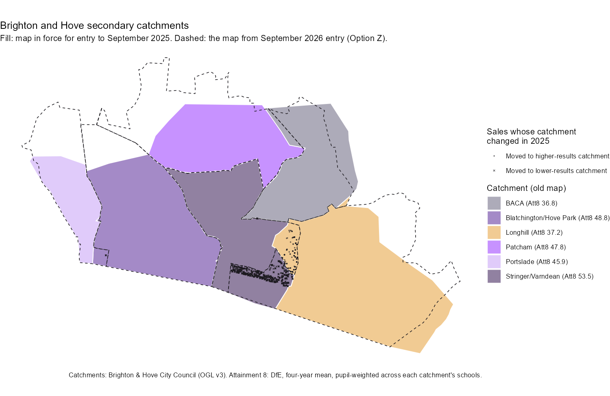
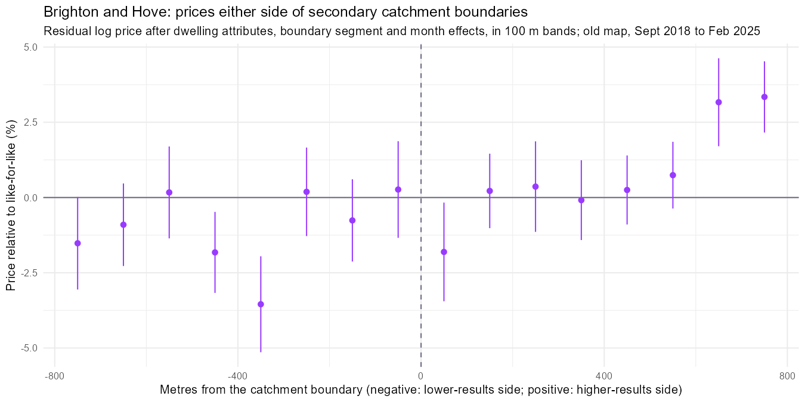

```{r}
#| label: setup
suppressPackageStartupMessages({ library(data.table); library(ggplot2); library(knitr) })
rd <- function(f) readRDS(here::here("data", f))
pm <- rd("premium_models.rds"); pop <- rd("popularity_models.rds"); gap <- rd("gap_models.rds")
ev <- rd("ofsted_event_study.rds"); het <- rd("heterogeneity.rds"); tg <- rd("three_groups.rds")
ec <- rd("epc_controls.rds"); bm <- rd("barrier_models.rds"); bh <- rd("bh_catchments.rds")
ks <- rd("ks4_at_sale.rds"); pp <- rd("premium_pounds.rds"); imp <- rd("importance.rds")
gbp <- function(x) paste0(ifelse(x < 0, "−£", "£"), formatC(round(abs(x), -2), format = "d", big.mark = ","))
p25 <- function(t, d) pp$P[indicator == "near_sec_out" & yr == 2025 & type == t & design == c("raw", "district", "lsoa")[d]]
f1 <- function(x) formatC(x, format = "f", digits = 1); f2 <- function(x) formatC(x, format = "f", digits = 2)
sg <- function(x) ifelse(x > 0, paste0("+", f1(x)), f1(x)); sg2 <- function(x) ifelse(x > 0, paste0("+", f2(x)), f2(x))
big <- function(x) format(x, big.mark = ",")
pal3 <- c("Raw" = "#c9a2f5", "Same kind of home" = "#993bff", "Same home, same neighbourhood" = "#361a54")
th <- theme_minimal(base_size = 11) + theme(legend.position = "top", plot.title.position = "plot", panel.grid.minor = element_blank())
mlab <- function(x) factor(x, c("raw", "hedonic", "neighbourhood"), names(pal3))
pci <- function(b, se) list(pct = 100 * (exp(b) - 1), lo = 100 * (exp(b - 1.96 * se) - 1), hi = 100 * (exp(b + 1.96 * se) - 1))
E <- copy(pm$est); E[, model := as.character(model)]
get_p <- function(ind, mod) E[indicator == ind & model == mod, premium]
```

::: {.callout-note}
## About this page
- **What it is:** working results from the [`school_house_prices`](https://github.com/adamdennett/school_house_prices) repository (scripts R/01 to R/18). All numbers are read from the saved model outputs when the page is rendered.
- **Data:** published only: HM Land Registry Price Paid, the EPC register, DfE, Ofsted and ONS. No pupil-level records are used.
- **Related:**
  - the [School Value Added](https://adamdennett.github.io/school_value_added/) site, where the Attainment 8 and Value Added v2.1 measures used here come from;
  - its [pupil numbers and school places](https://adamdennett.github.io/school_value_added/demographics.html) page, on births, fertility and housing costs;
  - [Why Brighton and Hove has so few young children](https://adamdennett.github.io/school_value_added/bh_births_note.html), a note for the council.
:::

## In short

- **The raw premium is real, and about the size the councillor quoted.** Homes with an Outstanding state secondary within 10 minutes' walk sold for `r f1(get_p("outst_sec10", "raw"))`% more than other homes sold in the same month. Where the nearest secondary is in England's top 10% for Attainment 8, the figure is `r sg(get_p("top_att8", "raw"))`%.
- **Location and size are most of the price; schools are a small part, and almost all of it is location.** Split the way we split Attainment 8, the district and neighbourhood deprivation account for `r f1(100 * sum(imp$SH[job == "A_all" & block %in% c("district", "deprivation"), share]))`% of what the model explains, and size `r f1(100 * imp$SH[job == "A_all" & block == "size", share])`%. The nearest schools account for `r f1(100 * sum(imp$SH[job == "A_all" & block %in% c("ofsted", "results", "intake"), share]))`%. Added last, they add less than a tenth of a percentage point. See [What matters most](#what-matters-most-in-the-price-of-a-home).
- **Most of it is the kind of home and the kind of area.**
  - Comparing the same kind of home in the same district, the premiums fall to `r sg(get_p("outst_sec10", "hedonic"))`% and `r sg(get_p("top_att8", "hedonic"))`%.
  - Comparing homes within the same LSOA (a neighbourhood of about 700 homes), they fall to `r sg(get_p("outst_sec10", "neighbourhood"))`% and `r sg(get_p("top_att8", "neighbourhood"))`%.
  - This is Tan and Dennett's Brighton result, nationally.
  - **In pounds (2025, a semi-detached house at the median price):**
    - near an Outstanding secondary, about `r gbp(p25("Semi-detached", 1)$gbp)` more raw;
    - `r gbp(p25("Semi-detached", 2)$gbp)` for the same kind of home in the same local authority;
    - effectively nothing in the same neighbourhood.
    - See [In pounds](#in-pounds-what-a-typical-home-costs-extra).
  - **It holds with every characteristic of the home we can get from its EPC, and for the same property sold twice.** It is the neighbourhood, more than the home, that accounts for the raw gap. See [Does it hold with every property characteristic?](#does-it-hold-with-every-property-characteristic)
- **Buyers pay for results and intake, not for value added.**
  - Within neighbourhoods, a school-level standard deviation of Attainment 8 is worth about 1% of the price.
  - Value added is worth nothing, or slightly less than nothing.
  - Higher results only carry a premium when the school also has fewer pupils on free school meals.
- **The premium is larger where neighbouring schools differ more, and where the address buys priority.**
  - It is larger where the gap between the two nearest schools is large.
  - It is larger where the school admits by distance or catchment. There is none where the better school is a faith school.
- **In Brighton and Hove, real catchment boundaries show no price jump at the line.** This is consistent with random allocation within catchments since 2008, and with Tan and Dennett. See [Brighton and Hove: real catchments](#brighton-and-hove-real-catchments)
- **Buyers price a school's standing, not this year's results.** Year-to-year changes in published Attainment 8 are barely priced. See [Results at the date of sale](#results-at-the-date-of-sale).
- **This corroborates Greaves and Venturin (2026), on a national design.**
  - **What we share:** a small premium, concentrated where schools differ most and bundled with intake; value added unpriced.
  - **What differs:** ours is smaller still, and we find no "escaping the bottom" premium.
  - **What is new here:** admission rules, popularity, change over time, repeat sales and Brighton and Hove's real catchments.
  - See [How this compares](#how-this-compares-with-greaves-and-venturin-2026).
- **Prices barely respond when a school's Ofsted grade changes.** Upgrades add a few tenths of a per cent over two to three years. Downgrades show no clear fall.

## Data and how they were linked

| Step | Source | What it gives | Count |
|---|---|---|---|
| R/01 | HM Land Registry Price Paid (complete file, October 2026), linked to the EPC register (bulk download, 2008–2026) with Chris Beech's DuckDB version of Bin Chi's address-matching method | Price, date and type of each sale, with floor area and rooms | 24,618,450 of 29,743,989 sales matched (83%) |
| R/02 | ONS Postcode Directory, August 2026 | 2021 Output Area, LSOA, MSOA, district, IMD 2025 rank | 2,413,799 postcodes |
| R/03 | EPC register | Construction age band, built form, energy efficiency, tenure | 100% of matched sales |
| R/04 | National walking routes, `school_active_travel` (Zenodo 10.5281/zenodo.24188820) | Walking minutes from every Output Area to every state school | 870,225 pairs within 20 minutes |
| R/05 | Ofsted official statistics as at 31 August 2018–2023, and management information as at 30 September 2026; GIAS successor links; Value Added v2.1 and four-year Attainment 8 (`school_value_added`) | Each sale's nearest primary and secondary, their Ofsted grade at the date of sale, minutes to the nearest Outstanding school, and the secondary's Attainment 8 and value added | `r big(6401832)` sales, September 2018 to September 2026 |
| R/07 | DfE, *Primary and secondary school applications and offers*, school level, entry 2014–2026 | First preferences per place offered; FSM share; faith and selective status | Popularity for 86–87% of sales |
| R/13 | ONS Output Areas (December 2021) boundaries EW BFE V9; OpenStreetMap (Geofabrik England, November 2026); Network Rail station list with ELR and mileage (`../rail/RailStations.csv`) | Lines where the nearest school changes; major roads, rivers and canals, railways | 7,510 lines |
| R/15 | Brighton & Hove City Council secondary catchment maps, old and Option Z (OGL v3; copies in `../bh_school_system/data`) | Real catchment boundaries and the 2025 redraw | `r big(bh$n_sales)` Brighton and Hove sales |

**Sample for the models:**

- standard residential sales (Price Paid category A) with complete EPC attributes;
- `r big(pm$n_sales)` sales from `r format(pm$years[1], "%B %Y")` to `r format(pm$years[2], "%B %Y")`.

**"Nearest school":** the nearest by walking time from the sale's Output Area. It is not the catchment, which we do not have nationally. Where admission is by distance this is a close proxy; elsewhere it is noisier, and estimates will be pulled towards zero.

## Raw against like for like

```{r}
#| label: fig-premium
#| fig-cap: "Price premium near 'good' schools: raw, for the same kind of home in the same district, and for the same kind of home in the same LSOA. Points are estimates; lines are 95% intervals."
P <- copy(pm$est)[, model := mlab(as.character(model))]
P[, label := factor(label, rev(unique(pm$est$label)))]
ggplot(P, aes(premium, label, colour = model)) + geom_vline(xintercept = 0, colour = "#6b6680") +
  geom_pointrange(aes(xmin = lo, xmax = hi), position = position_dodge2(width = 0.6, reverse = TRUE), size = 0.35) +
  scale_colour_manual(values = pal3, name = NULL) + labs(x = "Price premium (%), 95% interval", y = NULL) + th
```

```{r}
#| label: tbl-premium
#| tbl-cap: "Price premium (%) with 95% interval, by design. Share = share of sales with the indicator."
T <- dcast(copy(pm$est)[, cell := sprintf("%s (%s to %s)", sg(premium), f1(lo), f1(hi))][, model := as.character(model)],
           label + share_treated ~ model, value.var = "cell")
T <- T[match(unique(pm$est$label), label), .(`Near a 'good' school` = label, Share = paste0(f1(100 * share_treated), "%"),
                                              Raw = raw, `Same kind of home` = hedonic, `Same home, same LSOA` = neighbourhood)]
kable(T)
```

::: {.callout-tip collapse="true"}
## The models
For sale $i$ in month $t$, district $d$ (or LSOA $l$), with school indicator $S_i$ and dwelling attributes $X_i$:

$$\log p_i = \beta S_i + \mu_t + \varepsilon_i \qquad \text{(raw)}$$
$$\log p_i = \beta S_i + X_i'\gamma + \mu_t + \delta_d + \varepsilon_i \qquad \text{(same kind of home)}$$
$$\log p_i = \beta S_i + X_i'\gamma + \mu_t + \lambda_l + \varepsilon_i \qquad \text{(same home, same neighbourhood)}$$

$X_i$: log floor area, habitable rooms, property type, built form, construction age band, energy efficiency score, tenure, new build. Premium $= 100(e^{\beta} - 1)$. Standard errors are clustered by MSOA.

```r
feols(lp ~ outst_sec10 + lfa + i(rooms) + i(propertytype) + i(built_form) + i(construction_age_band) +
        eff + i(duration) + i(oldnew) | ym + lsoa21cd, data = S, cluster = ~msoa21cd)   # R/06
```
:::

## What matters most in the price of a home?

```{r}
#| include: false
im <- rd("importance.rds"); SH <- copy(im$SH)
ia <- SH[job == "A_all"]; ib <- SH[job == "B_all"]; ia2 <- SH[job == "A_all_s2"]
iv <- function(d, b, v = "share") d[block == b][[v]]
pc <- function(x) paste0(f1(100 * x), "%")
sch_b <- c("ofsted", "results", "intake")
sch <- SH[block %in% sch_b, .(share = sum(share), shapley = sum(shapley), last = sum(last), alone_results = alone[block == "results"]), by = .(job, design, group)]
```

Before asking how much a school adds, it helps to know how much of a price
anything explains. We split the model's explained variance between blocks of
variables in the same way as for Attainment 8 (the *Shared variance and
relative importance* note in `school_attainment_tool`). Each block's
**Shapley (LMG) share** is its average contribution over every order in which
the blocks could enter the model. Variance that two blocks share is divided
between them, not counted twice, and the shares add up to the full model's R².
Two simpler measures sit beside it:

- **R² alone:** the block on its own, credited with everything it shares with
  others.
- **Added last:** what the block adds once everything else is in. It is
  credited with nothing shared.

**Location and size are the price of a home. Schools are a small part of it,
and almost all of that part is location.**

- **The full model** (11 blocks, district and deprivation as location) explains
  `r pc(ia$full_r2[1])` of the variation in log price.
- **Where the home is** takes over half of that: the local authority
  `r pc(iv(ia, "district"))` and neighbourhood deprivation `r pc(iv(ia, "deprivation"))`.
- **Its size** (floor area and rooms) takes `r pc(iv(ia, "size"))` and its type
  and built form `r pc(iv(ia, "type"))`.
- **The nearest schools together** (results, intake and Ofsted grades) take
  `r pc(sch[job == "A_all", share])`:
  - results `r pc(iv(ia, "results"))`;
  - intake `r pc(iv(ia, "intake"))`;
  - Ofsted grades `r pc(iv(ia, "ofsted"))`.
- **On their own,** the nearest secondary's results explain
  `r pc(iv(ia, "results", "alone"))` of the variation in price, more than the
  age, energy rating and tenure of the home together. That is the raw
  premium.
- **Added last,** the three school blocks together add
  `r f2(100 * sch[job == "A_all", last])` percentage points of R². With the
  neighbourhood fixed as an LSOA, they add nothing
  measurable (`r formatC(100 * sch[job == "B_all", last], format = "f", digits = 3)` points).
  Almost everything schools appear to explain, location explains already.
- **The age band and energy rating hardly matter** once size and type are
  known (`r pc(iv(ia, "age"))` and `r pc(iv(ia, "energy"))`).

```{r}
#| label: fig-importance
#| fig-cap: "What explains the price of a home: each block's R² on its own, its Shapley (LMG) share, and what it adds when entered last. Location as local authority district and IMD 2025 decile; 250,000 sales sampled from the model sample. Labels: Shapley share of the explained variance."
knitr::include_graphics(here::here("figures", "importance_district.png"))
```

```{r}
#| label: tbl-importance
#| tbl-cap: "Shapley (LMG) decomposition of R², log price. Location as local authority district and neighbourhood deprivation (design A), or as the LSOA (design B). A second random sample of 250,000 sales gives the same shares to within 0.2 points (column 'A, second sample')."
lab <- im$labels
T <- merge(ia[, .(block, label, alone, shapley, share, last)], ia2[, .(block, share2 = share)], by = "block")
T <- merge(T, ib[, .(block, shareB = share, lastB = last)], by = "block", all = TRUE)
T[block == "lsoa", label := lab[["lsoa"]]]
T <- T[order(-pmax(share, shareB, na.rm = TRUE))]
kable(T[, .(Block = label, `R² alone (A)` = ifelse(is.na(alone), "", f2(alone)), `Shapley R² (A)` = ifelse(is.na(shapley), "", f2(shapley)), `Share (A)` = ifelse(is.na(share), "", pc(share)),
            `A, second sample` = ifelse(is.na(share2), "", pc(share2)), `Added last (A)` = ifelse(is.na(last), "", formatC(last, format = "f", digits = 4)),
            `Share (B)` = ifelse(is.na(shareB), "", pc(shareB)), `Added last (B)` = ifelse(is.na(lastB), "", formatC(lastB, format = "f", digits = 4)))])
```

**With the neighbourhood itself as location (design B)** the full model
explains `r pc(ib$full_r2[1])`. The LSOA takes `r pc(iv(ib, "lsoa"))` of that
and size `r pc(iv(ib, "size"))`. The school blocks keep about the same Shapley
share (`r pc(sch[job == "B_all", share])`). But their added-last contribution
falls to effectively zero, because almost every school measure is fixed within
an LSOA.

**Whose results.** Using disadvantaged or non-disadvantaged pupils' results in
place of all pupils' barely changes the picture:

```{r}
#| label: fig-importance-groups
#| fig-cap: "Shapley (LMG) share of the explained variance for the three school blocks, with the nearest secondary's results measured for all, disadvantaged and non-disadvantaged pupils. Design A (district and deprivation) and design B (LSOA)."
#| fig-height: 3.6
G <- SH[block %in% sch_b & job != "A_all_s2"][, `:=`(grp = factor(c(all = "All pupils", dis = "Disadvantaged", nd = "Non-disadvantaged")[group], c("All pupils", "Disadvantaged", "Non-disadvantaged")),
                                                    des = c(A = "A: district and deprivation", B = "B: LSOA")[design], lab = factor(im$labels[block], rev(im$labels[sch_b])))]
ggplot(G, aes(100 * share, lab, fill = grp)) + geom_col(position = position_dodge(width = 0.75), width = 0.7) + facet_wrap(~des) +
  scale_fill_manual(values = c("All pupils" = "#361a54", "Disadvantaged" = "#993bff", "Non-disadvantaged" = "#c9a2f5"), name = NULL) +
  labs(x = "Shapley share of the explained variance (%)", y = NULL) + th
```

```{r}
#| label: tbl-importance-groups
#| tbl-cap: "School blocks: Shapley share of the explained variance and R² alone for the results block, by whose results are used."
kable(dcast(G[, .(des, Block = lab, grp, v = sprintf("%s (alone %s)", pc(share), f2(alone)))], des + Block ~ grp, value.var = "v")[, .(Design = des, Block, `All pupils`, Disadvantaged, `Non-disadvantaged`)])
```

- **Disadvantaged pupils' results** carry less (`r pc(iv(SH[job == "A_dis"], "results"))`
  against `r pc(iv(ia, "results"))`). On their own they explain
  `r pc(iv(SH[job == "A_dis"], "results", "alone"))` of the variation in price,
  against `r pc(iv(ia, "results", "alone"))` for all pupils.
- **Non-disadvantaged pupils' results** carry slightly more
  (`r pc(iv(SH[job == "A_nd"], "results"))`).
- **The pattern matches the earlier finding:** buyers track the school's
  overall standing and intake, not how it does for disadvantaged children.

::: {.callout-tip collapse="true"}
## The model
$$\log p_i = \sum_{b \in B} X_{ib}'\beta_b + \sum_{f \in B} \alpha_{f(i)} + \varepsilon_i$$

$B$ is a set of blocks. Each block is either regressors or a set of fixed
effects:

- size: log floor area, rooms;
- type: property type, built form;
- age band;
- energy efficiency;
- tenure and new build;
- [month of sale];
- [district] with IMD 2025 decile, or [LSOA];
- Ofsted grade of the nearest primary and secondary;
- the nearest secondary's standardised Attainment 8 and Value Added v2.1;
- its free school meals share.

The Shapley value of block $j$, over the $k$ blocks, is

$$\phi_j = \sum_{S \subseteq B \setminus \{j\}} \frac{|S|!\,(k-|S|-1)!}{k!}\left[R^2(S \cup \{j\}) - R^2(S)\right].$$

- **How it is computed:** from the full subset lattice, $2^{11} = 2{,}048$
  models for design A and $2^{10} = 1{,}024$ for design B, each fitted with
  `fixest::feols`.
- **The samples:**
  - **Model sample:** the `r big(im$n_sales)` sales whose nearest secondary has
    all six results measures and a free school meals share.
  - **Design A:** 250,000 random sales, with a second sample of the same size
    to check stability.
  - **Design B:** 1,000,000 random sales, so that LSOA effects rest on enough
    sales.

```r
feols(lp ~ lfa + i(rooms) + i(propertytype) + i(built_form) + ... + a8_all_z + va_all_z + fsm10 | ym + lad26cd, data = s1)   # one of 2,048 subsets, R/18
```

- **Limits:** R² decomposition describes the data, not causes.
- **Measures as proxies:** a block's share depends on how well its measures
  capture it. Location measured as an LSOA absorbs more than district and IMD
  can.
:::

## In pounds: what a typical home costs extra

Percentages hide what people pay, so R/16 converts them to pounds.

- **The estimate:** the premium is estimated separately for each property type in each year. Each type-year is compared with homes of the same type sold that year, in the same three designs.
- **The conversion:** each premium is applied to that type's median price that year (England, all matched sales).
- **The measure:** "near a good school" here is "the nearest state secondary is Outstanding" at the date of sale (`r f1(100 * E[indicator == "near_sec_out" & model == "raw", share_treated])`% of sales).

```{r}
#| label: setup-pounds
PP <- copy(pp$P)[indicator == "near_sec_out"]
PP[, `:=`(design = factor(design, c("raw", "district", "lsoa"), c("Raw: homes of the same type sold that year", "Same kind of home, same local authority", "Same kind of home, same neighbourhood (LSOA)")),
          type = factor(type, c("Detached", "Semi-detached", "Terraced", "Flat or maisonette")))]
P25 <- PP[yr == 2025]
```

```{r}
#| label: fig-pounds-2025
#| fig-height: 5.5
#| fig-width: 10
#| column: page-right
#| fig-cap: "Extra paid in 2025 for a home whose nearest state secondary is Outstanding, by property type: raw, like for like in the same local authority, and like for like in the same neighbourhood. Bars are estimates, whiskers 95% intervals. Panel titles give the median price of that type in 2025."
lab25 <- unique(P25[, .(type, median_price)])[order(type)][, lab := paste0(type, " (median ", gbp(median_price), ")")]
P25b <- merge(P25, lab25[, .(type, lab)], by = "type")[, lab := factor(lab, lab25$lab)]
P25b[, short := factor(as.integer(design), 1:3, c("Raw", "Same local\nauthority", "Same\nneighbourhood"))]
ggplot(P25b, aes(short, gbp / 1000, fill = design)) + geom_hline(yintercept = 0, colour = "#6b6680") +
  geom_col(width = 0.7) + geom_errorbar(aes(ymin = gbp_lo / 1000, ymax = gbp_hi / 1000), width = 0.2, colour = "#6b6680") +
  geom_text(aes(label = gbp(gbp), y = pmax(gbp_hi, 0) / 1000), vjust = -0.5, size = 3.4) +
  facet_wrap(~lab, nrow = 1) + scale_fill_manual(values = c("#c9a2f5", "#993bff", "#361a54"), guide = "none") +
  scale_y_continuous(labels = function(x) paste0("£", x, "k"), expand = expansion(mult = c(0.05, 0.12))) +
  labs(x = NULL, y = "Extra paid (£)") + th + theme(strip.text = element_text(face = "bold"))
```

```{r}
#| label: fig-pounds
#| fig-height: 4.6
#| column: page-right
#| fig-cap: "Extra paid for a home whose nearest state secondary is Outstanding, by property type and year (95% intervals)."
ggplot(PP, aes(yr, gbp / 1000, colour = design, fill = design)) + geom_hline(yintercept = 0, colour = "#6b6680") +
  geom_ribbon(aes(ymin = gbp_lo / 1000, ymax = gbp_hi / 1000), alpha = 0.18, colour = NA) + geom_line(linewidth = 0.7) + geom_point(size = 1.3) +
  facet_wrap(~type, nrow = 1) + scale_colour_manual(values = c("#c9a2f5", "#993bff", "#361a54"), name = NULL, aesthetics = c("colour", "fill")) +
  guides(colour = guide_legend(nrow = 3), fill = guide_legend(nrow = 3)) +
  scale_x_continuous(breaks = seq(2018, 2026, 2)) + scale_y_continuous(labels = function(x) paste0("£", x, "k")) +
  labs(x = NULL, y = "Extra paid (£)") + th
```

```{r}
#| label: tbl-pounds
#| tbl-cap: "Extra paid for a home whose nearest state secondary is Outstanding (% and £, applied to the median price of that type that year)."
T <- dcast(PP[, cell := sprintf("%s%% (%s)", sg(pct), gbp(gbp))], type + yr + median_price ~ design, value.var = "cell")
kable(T[, .(Type = type, Year = yr, `Median price` = gbp(median_price), Raw = `Raw: homes of the same type sold that year`,
            `Same local authority` = `Same kind of home, same local authority`, `Same LSOA` = `Same kind of home, same neighbourhood (LSOA)`)])
```

**In 2025, for a semi-detached house at the median price (`r gbp(p25("Semi-detached", 1)$median_price)`):**

- **Raw gap:** one whose nearest secondary is Outstanding sold for about `r gbp(p25("Semi-detached", 1)$gbp)` more than other semis that year.
- **Like for like in the same local authority:** about `r gbp(p25("Semi-detached", 2)$gbp)`.
- **Like for like in the same neighbourhood:** `r gbp(p25("Semi-detached", 3)$gbp)`, effectively nothing.

The other types:

- **Terraced** (median `r gbp(p25("Terraced", 1)$median_price)`): `r gbp(p25("Terraced", 1)$gbp)` raw, `r gbp(p25("Terraced", 2)$gbp)` in the same authority, `r gbp(p25("Terraced", 3)$gbp)` in the same neighbourhood.
- **Detached** (median `r gbp(p25("Detached", 1)$median_price)`): `r gbp(p25("Detached", 1)$gbp)`, `r gbp(p25("Detached", 2)$gbp)` and `r gbp(p25("Detached", 3)$gbp)`.
- **Flats** (median `r gbp(p25("Flat or maisonette", 1)$median_price)`): `r gbp(p25("Flat or maisonette", 1)$gbp)`, `r gbp(p25("Flat or maisonette", 2)$gbp)` and `r gbp(p25("Flat or maisonette", 3)$gbp)`.

**The like-for-like premium has shrunk since 2018,** for every type. One likely reason: "Outstanding" has grown stale. Many Outstanding schools went years without inspection, and graded inspections ended in September 2024. The raw gap has grown with prices.

## Does it hold with every property characteristic?

Every like-for-like model in this report already controls for the home's characteristics from its EPC. The "raw" column is the only one without them. R/14 checks this two ways.

### Adding the EPC detail step by step

```{r}
#| label: setup-ladder
L <- copy(ec$ladder)[, `:=`(rung_lab = factor(ec$lab_rung[rung], ec$lab_rung), fe_lab = fifelse(fe == "ym", "Month effects only", "Month and LSOA effects"),
                            term_lab = factor(term, c("att8_z", "va_z", "near_sec_out"), c("Attainment 8 (per SD)", "Value added (per SD)", "Nearest secondary Outstanding")))]
lp_ <- function(t, r, f) L[term == t & rung == r & fe == f, pct]
```

The nearest state secondary's Attainment 8 is estimated on five sets of property controls (C0 to C4), first with month effects only, then also with LSOA effects. Value added is entered alongside it, and "nearest secondary is Outstanding" is estimated separately.

- **C0:** no property controls.
- **C1:** what Price Paid alone gives: property type, freehold or leasehold, new build.
- **C2:** adds the EPC's floor area and rooms.
- **C3:** adds the EPC's construction age band, built form and energy efficiency. This is the main specification.
- **C4:** adds every other usable EPC field:
  - floor area decile by property type;
  - energy rating band;
  - main fuel and mains gas;
  - floor level for flats;
  - extensions;
  - heated rooms;
  - EPC property type;
  - years from the EPC inspection to the sale.

```{r}
#| label: fig-ladder
#| fig-width: 11
#| column: page-right
#| fig-cap: "Premium with more and more of the home's EPC characteristics as controls, with and without LSOA fixed effects (95% intervals)."
ggplot(L, aes(pct, rung_lab, colour = fe_lab)) + geom_vline(xintercept = 0, colour = "#6b6680") +
  geom_pointrange(aes(xmin = lo, xmax = hi), position = position_dodge2(width = 0.5, reverse = TRUE), size = 0.3) +
  facet_wrap(~term_lab, scales = "free_x") + scale_y_discrete(limits = rev) +
  scale_colour_manual(values = c("Month effects only" = "#c9a2f5", "Month and LSOA effects" = "#361a54"), name = NULL) +
  labs(x = "Price premium (%), 95% interval", y = NULL) + th
```

```{r}
#| label: tbl-ladder
#| tbl-cap: "Premium (%) with 95% interval, and the within R² of the model, by set of property controls."
T <- dcast(L[, cell := sprintf("%s (%s to %s)", sg2(pct), f2(lo), f2(hi))], rung_lab + fe_lab ~ term_lab, value.var = "cell")
R2 <- L[term %in% c("att8_z", "near_sec_out"), .(r2 = f2(r2[1])), by = .(rung_lab, fe_lab, term)][, dcast(.SD, rung_lab + fe_lab ~ term, value.var = "r2")]
T <- merge(T, R2, by = c("rung_lab", "fe_lab"))[order(fe_lab != "Month effects only", rung_lab)]
kable(T, col.names = c("Property controls", "Area effects", "Attainment 8 (per SD)", "Value added (per SD)", "Nearest secondary Outstanding", "R² (Attainment 8 model)", "R² (Outstanding model)"))
```

**What the ladder shows**

- **The home's characteristics explain little of the raw premium; the neighbourhood explains most of it.**
  - **With month effects only,** adding the home's characteristics takes the Attainment 8 premium from `r sg(lp_("att8_z", "C0", "ym"))`% to `r sg(lp_("att8_z", "C3", "ym"))`% per SD, and `r sg(lp_("att8_z", "C4", "ym"))`% with every EPC field. The "nearest secondary Outstanding" premium goes from `r sg(lp_("near_sec_out", "C0", "ym"))`% to `r sg(lp_("near_sec_out", "C4", "ym"))`%. The EPC fields add a great deal of explanatory power (within R² from `r f2(L[term == "att8_z" & rung == "C0" & fe == "ym", r2])` to `r f2(L[term == "att8_z" & rung == "C4" & fe == "ym", r2])`) but leave the school premium mostly in place.
  - **Comparing homes in the same LSOA** is what removes it: `r sg2(lp_("att8_z", "C0", "ym + lsoa21cd"))`% per SD even with no property controls.
- **Once homes are compared within the same LSOA, the EPC detail barely moves the estimate:**
  - Attainment 8: `r sg2(lp_("att8_z", "C0", "ym + lsoa21cd"))`% with no property controls, `r sg2(lp_("att8_z", "C3", "ym + lsoa21cd"))`% with the main controls, `r sg2(lp_("att8_z", "C4", "ym + lsoa21cd"))`% with every EPC field;
  - nearest secondary Outstanding: `r sg2(lp_("near_sec_out", "C0", "ym + lsoa21cd"))`%, `r sg2(lp_("near_sec_out", "C3", "ym + lsoa21cd"))`% and `r sg2(lp_("near_sec_out", "C4", "ym + lsoa21cd"))`%.
- **Value added stays at or below zero** on every set of controls.

### The same property, sold more than once

```{r}
#| label: setup-repeat
Rp <- copy(ec$repeat_sales)
```

- **The sample:** `r big(ec$props_repeat)` properties (by EPC UPRN) were sold more than once between September 2018 and September 2026, giving `r big(ec$n_repeat)` sales.
- **What is held constant:** property fixed effects absorb everything fixed about the home and its plot, measured or not. District × month effects absorb local price trends.
- **What can be estimated:** only school measures that change between a property's sales. These are Ofsted grades at the date of sale and each year's popularity.
- **The comparison:** each measure is also estimated on the same sales with LSOA effects instead of property effects.

```{r}
#| label: fig-repeat
#| fig-cap: "Premium for school measures that change over time: the same property (repeat sales) against the same LSOA, on the same sales (95% intervals)."
Rp[, label := factor(label, rev(unique(label)))]
ggplot(Rp, aes(pct, label, colour = design)) + geom_vline(xintercept = 0, colour = "#6b6680") +
  geom_pointrange(aes(xmin = lo, xmax = hi), position = position_dodge2(width = 0.5, reverse = TRUE), size = 0.3) +
  scale_colour_manual(values = c("Same property (repeat sales)" = "#993bff", "Same LSOA (same sales)" = "#c9a2f5"), name = NULL) +
  labs(x = "Price premium (%), 95% interval", y = NULL) + th
```

```{r}
#| label: tbl-repeat
#| tbl-cap: "Premium (%) with 95% interval. Changers = repeat-sold properties whose value of the measure differs between their sales (what identifies the repeat-sales estimate)."
kable(dcast(Rp[, cell := sprintf("%s (%s to %s)", sg2(pct), f2(lo), f2(hi))], label + changers ~ design, value.var = "cell")[order(-as.integer(label))][, changers := big(changers)],
      col.names = c("School measure", "Changers", "Same LSOA (same sales)", "Same property (repeat sales)"))
```

```{r}
#| label: setup-repeat2
rp <- function(l, d) Rp[label == l & design == d]
```

**The same property tells the same story, a little smaller.**

- **Nearest secondary becomes Outstanding:** when a property's nearest secondary is Outstanding at one sale and not at the other, the price differs by `r sg2(rp("Nearest secondary Outstanding", "Same property (repeat sales)")$pct)`%. The same-LSOA estimate on the same sales is `r sg2(rp("Nearest secondary Outstanding", "Same LSOA (same sales)")$pct)`%.
- **Nearest primary:** `r sg2(rp("Nearest primary Outstanding", "Same property (repeat sales)")$pct)`% (same LSOA: `r sg2(rp("Nearest primary Outstanding", "Same LSOA (same sales)")$pct)`%).
- **Popularity:** a standard deviation more first preferences per place adds `r sg2(rp("Secondary popularity (per SD)", "Same property (repeat sales)")$pct)`% for the secondary and `r sg2(rp("Primary popularity (per SD)", "Same property (repeat sales)")$pct)`% for the primary.
- **The scale:** every school measure is worth under 1% of the price when the home itself is held fixed.

::: {.callout-tip collapse="true"}
## The models
Control ladder, for rung $k$ with property controls $X_i^{(k)}$:
$$\log p_i = \beta_1 A8_{s(i)} + \beta_2 VA_{s(i)} + X_i^{(k)\prime}\gamma + \mu_t \;[+\, \lambda_l] + \varepsilon_i$$
Repeat sales, for property $h$ in district $d$:
$$\log p_{ht} = \beta S_{ht} + Z_{ht}'\gamma + \alpha_h + \mu_{d,t} + \varepsilon_{ht}$$
with $Z_{ht}$ the EPC measures that can change between sales (log floor area, rooms, energy efficiency).
```r
feols(lp ~ att8_z + va_z + <rung k controls> | ym + lsoa21cd, data = A, cluster = ~msoa21cd)            # R/14 A
feols(lp ~ near_sec_out + lfa + i(rooms) + eff | uprn + lad26cd^ym, data = R, cluster = ~uprn)           # R/14 B
```
:::

## Results, value added and popularity

The nearest secondary's Attainment 8, value added and popularity (log first preferences per place) are entered together, each per standard deviation (R/08).

```{r}
#| label: fig-sec3
#| fig-cap: "Premium per standard deviation of each measure, entered together (nearest state secondary)."
X <- copy(pop$sec3)[, c("pct", "lo", "hi") := pci(b, se)][, model := mlab(model)]
X[, term := factor(term, rev(c("att8_z", "va_z", "pop_z")), rev(c("Attainment 8", "Value added", "Popularity (first preferences per place)")))]
ggplot(X, aes(pct, term, colour = model)) + geom_vline(xintercept = 0, colour = "#6b6680") +
  geom_pointrange(aes(xmin = lo, xmax = hi), position = position_dodge2(width = 0.6, reverse = TRUE), size = 0.35) +
  scale_colour_manual(values = pal3, name = NULL) + labs(x = "Price premium (%) per standard deviation, 95% interval", y = NULL) + th
```

```{r}
#| label: tbl-sec3
#| tbl-cap: "Premium (%) per standard deviation, the three measures together."
kable(dcast(X[, cell := sprintf("%s (%s to %s)", sg2(pct), f2(lo), f2(hi))], term ~ model, value.var = "cell")[order(-as.integer(term))], col.names = c("Measure", levels(X$model)))
```

**Popularity carries almost nothing once results are known.**

- Within LSOAs:
  - an over-subscribed nearest secondary (two or more first preferences per place) adds `r sg(pci(pop$sec_over[model == "neighbourhood", b], pop$sec_over[model == "neighbourhood", se])$pct)`%;
  - an over-subscribed primary adds `r sg(pci(pop$pri_over[model == "neighbourhood", b], pop$pri_over[model == "neighbourhood", se])$pct)`%.
- Raw, the same comparisons are `r sg(pci(pop$sec_over[model == "raw", b], 0)$pct)`% and `r sg(pci(pop$pri_over[model == "raw", b], 0)$pct)`%.
- Only `r f1(100 * pop$share_over_sec)`% of sales are near such a secondary, and `r f1(100 * pop$share_over_pri)`% near such a primary.

::: {.callout-tip collapse="true"}
## The model
$$\log p_i = \beta_1 A8_{s(i)} + \beta_2 VA_{s(i)} + \beta_3 \log(\text{first prefs per place})_{s(i)} + \theta\,\text{grammar}_{s(i)} + X_i'\gamma + \mu_t + \lambda_l + \varepsilon_i$$
with $s(i)$ the nearest state secondary, each measure standardised.

```r
feols(lp ~ att8_z + va_z + pop_z + sel + <controls> | ym + lsoa21cd, data = Sec, cluster = ~msoa21cd)   # R/08
```
:::

## Whose results? All, disadvantaged and non-disadvantaged pupils

Each pupil group's Attainment 8 and value added at the nearest secondary is entered together, one group at a time, on the same `r big(tg$n)` sales (R/12).

```{r}
#| label: fig-three
#| fig-cap: "Premium per school-level standard deviation of the nearest secondary's Attainment 8 and value added, by pupil group."
G3 <- rbind(tg$g_all, tg$g_dis, tg$g_nd)
G3[, `:=`(measure = fifelse(grepl("^a8", term), "Attainment 8", "Value added"), model = mlab(model),
          group = factor(group, rev(c("All pupils", "Disadvantaged pupils", "Non-disadvantaged pupils"))))]
ggplot(G3, aes(pct, group, colour = model)) + geom_vline(xintercept = 0, colour = "#6b6680") +
  geom_pointrange(aes(xmin = lo, xmax = hi), position = position_dodge2(width = 0.6, reverse = TRUE), size = 0.35) +
  facet_wrap(~measure, scales = "free_x") + scale_colour_manual(values = pal3, name = NULL) +
  labs(x = "Price premium (%) per standard deviation, 95% interval", y = NULL) + th
```

```{r}
#| label: tbl-three
#| tbl-cap: "Premium (%) per standard deviation, by pupil group (each group's two measures together)."
kable(dcast(G3[, cell := sprintf("%s (%s to %s)", sg2(pct), f2(lo), f2(hi))], group + measure ~ model, value.var = "cell")[order(-as.integer(group), measure)],
      col.names = c("Pupil group", "Measure", levels(G3$model)))
```

```{r}
#| label: tbl-joint
#| tbl-cap: "Disadvantaged and non-disadvantaged pupils' Attainment 8 together, with the school's free school meals share (per 10 percentage points)."
J <- copy(tg$joint)[, model := mlab(model)][, term := factor(term, c("a8_dis_z", "a8_nd_z", "fsm10"),
                                                              c("Attainment 8, disadvantaged pupils (per SD)", "Attainment 8, non-disadvantaged pupils (per SD)", "FSM share (per 10 points)"))]
kable(dcast(J[, cell := sprintf("%s (%s to %s)", sg2(pct), f2(lo), f2(hi))], term ~ model, value.var = "cell"), col.names = c("", levels(J$model)))
```

**The intake is what is priced.**

- **Each group alone:** within neighbourhoods, a standard deviation of the nearest secondary's Attainment 8 is worth about the same whichever group it is measured for:
  - all pupils `r sg(tg$g_all[model == "neighbourhood" & term == "a8_all_z", pct])`%;
  - disadvantaged pupils `r sg(tg$g_dis[model == "neighbourhood" & term == "a8_dis_z", pct])`%;
  - non-disadvantaged pupils `r sg(tg$g_nd[model == "neighbourhood" & term == "a8_nd_z", pct])`%.
- **Value added** is zero or slightly negative for every group.
- **Together with the free school meals share:** the FSM share carries the premium, at `r sg(tg$joint[model == "neighbourhood" & term == "fsm10", pct])`% per 10 percentage points. The two groups' results add little or nothing.
- **What a buyer gets:** the price follows who goes to the school more than how well a child like the buyer's would do there.

## Where neighbouring schools differ

This is a walking-time version of the catchment-boundary design in Greaves and Venturin (2026).

- **The sample:** `r big(gap$n_lsoa)` LSOAs split between two nearest state secondaries, with `r big(gap$n_sales)` sales.
- **The comparison:** like-for-like homes in the same LSOA, on the side whose nearest school has the higher Attainment 8 against the other side (R/09).
- **Overall:** the better side sells for `r sg(gap$m1$pct)`% (`r f2(gap$m1$lo)` to `r f2(gap$m1$hi)`).

```{r}
#| label: fig-gap
#| column: page-right
#| fig-height: 6.5
#| fig-cap: "Premium on the side whose nearest secondary has higher Attainment 8, same LSOA, like-for-like homes. Dark points: only sales within 3 minutes' walk of the line where the nearest school changes."
lab <- function(d, panel, set) copy(d)[, .(panel, set, group = sub(".*::", "", sub(":better$", "", term)), pct, lo, hi)]
F <- rbind(lab(gap$m1[, term := "All split LSOAs"], "Overall", "All sales"), lab(gap$m6[, term := "All split LSOAs"], "Overall", "Within 3 min of the line"),
           lab(gap$m2, "Attainment 8 gap", "All sales"), lab(gap$m6g, "Attainment 8 gap", "Within 3 min of the line"),
           lab(gap$m3, "Where the pair sits", "All sales"), lab(gap$m3q, "Pair's quartiles", "All sales"),
           lab(gap$m4, "Free school meals", "All sales"), lab(het$better_by_adm, "Better school admits by", "All sales"))
F[, panel := factor(panel, unique(panel))]
ggplot(F, aes(pct, group, colour = set)) + geom_vline(xintercept = 0, colour = "#6b6680") +
  geom_pointrange(aes(xmin = lo, xmax = hi), position = position_dodge2(width = 0.5, reverse = TRUE), size = 0.3) +
  facet_grid(panel ~ ., scales = "free_y", space = "free_y", switch = "y") +
  scale_colour_manual(values = c("All sales" = "#993bff", "Within 3 min of the line" = "#361a54"), name = NULL) +
  labs(x = "Premium (%) on the better side, 95% interval", y = NULL) + th +
  theme(strip.placement = "outside", strip.text.y.left = element_text(angle = 0, face = "bold", hjust = 1))
```

```{r}
#| label: tbl-gap
#| tbl-cap: "Premium (%) on the better side, with 95% interval."
kable(F[, .(Comparison = panel, Group = group, Sales = set, Premium = sprintf("%s (%s to %s)", sg2(pct), f2(lo), f2(hi)))])
```

**What this shows**

- **Gap size:** the premium rises with the size of the gap. In the top quartile (`r f1(gap$gap_cuts[4])` to `r f1(gap$gap_cuts[5])` Attainment 8 points) it is `r sg(gap$m2[grepl("Q4", term), pct])`%.
- **Where the pair sits:** it is clearest for "reaching the top" (third against fourth national quartile). There is no clear premium where both schools are below the median.
- **Results and intake:** it appears only where the higher-results school also has fewer pupils on free school meals.
- **Value added:** the side with the higher value added is worth `r sg(gap$m5[term == "better_va", pct])`%.
- **Admissions:** where the better school is a faith school, which mostly admits by faith rather than address, the premium is zero.
- **Compared with Greaves and Venturin:** the pattern matches their findings, but the magnitudes are about a quarter of theirs (their average is 2.5%, and 6.5% for large gaps). A walking-time "nearest school" is a noisier measure of priority than a catchment.

::: {.callout-tip collapse="true"}
## The model
For LSOAs split between two nearest secondaries, $B_i = 1$ if sale $i$'s nearest secondary is the one with the higher Attainment 8:
$$\log p_i = \sum_k \beta_k B_i \cdot 1[\text{group}_l = k] + X_i'\gamma + \mu_t + \lambda_l + \varepsilon_i$$
```r
feols(lp ~ i(gap_q, better) + <controls> | ym + lsoa21cd, data = G, cluster = ~msoa21cd)   # R/09
```
:::

### Without lines that follow major roads, rivers and railways

Greaves and Venturin drop boundaries that run along major roads, rivers and railways, where the two sides may differ for reasons other than the school. R/13 does the same for the walking-time lines.

**How each line is built**

- **The line:** the shared boundary between the two sides of each split LSOA. Each side is the union of the LSOA's 2021 Output Areas with the same nearest secondary.
- **Barriers it is checked against:**
  - **Major roads:** OpenStreetMap motorways, trunk and primary roads, within 25 m.
  - **Rivers and canals:** OpenStreetMap, within 25 m.
  - **Railways:** built from the Network Rail station list (`../rail/RailStations.csv`). Stations are ordered by mileage along each line of route (ELR) and joined in sequence, with chords over 10 km dropped. These are straight chords between stations, so the tolerance is 150 m. OpenStreetMap track within 25 m is a cross-check.
- **The rule:** a line "follows a barrier" if half or more of its length lies within the tolerance.

```{r}
#| label: setup-barriers
B <- copy(bm$B); Rb <- copy(bm$R)
sh <- function(x) paste0(f1(100 * mean(x >= 0.5)), "%")
rb <- function(s, sp, gr) Rb[set == s & spec == sp & group == gr]
```

**How many lines follow a barrier.** Of `r big(nrow(B))` lines (median length `r big(round(median(B$line_m)))` m):

- `r sh(B$road)` follow a major road;
- `r sh(B$river)` follow a river or canal;
- `r sh(B$rail_nr)` follow a railway built from the Network Rail stations, and `r sh(B$rail_osm)` a railway in OpenStreetMap;
- `r paste0(f1(100 * mean(B$bar_nr)), "%")` follow at least one barrier (`r paste0(f1(100 * mean(B$bar_osm)), "%")` with OpenStreetMap rail).

The two rail sources agree on `r paste0(f1(100 * mean((B$rail_nr >= 0.5) == (B$rail_osm >= 0.5))), "%")` of lines.

```{r}
#| label: fig-barriers
#| fig-height: 6.5
#| column: page-right
#| fig-cap: "Premium on the better side, same LSOA, like-for-like homes: all split LSOAs, without barrier lines, and on barrier lines only (95% intervals)."
P <- copy(Rb)[, set := factor(set, rev(unique(Rb$set)))][, spec := factor(spec, unique(Rb$spec))]
ggplot(P, aes(pct, group, colour = set)) + geom_vline(xintercept = 0, colour = "#6b6680") +
  geom_pointrange(aes(xmin = lo, xmax = hi), position = position_dodge(width = 0.7), size = 0.3) +
  facet_grid(spec ~ ., scales = "free_y", space = "free_y", switch = "y") +
  scale_colour_manual(values = c("All split LSOAs" = "#c9a2f5", "Without barrier lines (Network Rail stations)" = "#993bff",
                                 "Without barrier lines (OSM rail)" = "#5b2a99", "Barrier lines only" = "#e8a33d"), name = NULL,
                      guide = guide_legend(reverse = TRUE, nrow = 2)) +
  labs(x = "Premium (%) on the better side, 95% interval", y = NULL) + th +
  theme(strip.placement = "outside", strip.text.y.left = element_text(angle = 0, face = "bold", hjust = 1))
```

```{r}
#| label: tbl-barriers
#| tbl-cap: "Premium (%) on the better side with 95% interval, by sample."
kable(dcast(copy(Rb)[, cell := sprintf("%s (%s to %s)", sg2(pct), f2(lo), f2(hi))], spec + group ~ set, value.var = "cell")[order(match(spec, unique(Rb$spec)))],
      col.names = c("Model", "Group", sort(unique(Rb$set))))
```

```{r}
#| label: tbl-barrier-n
#| tbl-cap: "Sample sizes."
kable(unique(Rb[spec == "Overall", .(Sample = set, LSOAs = big(lsoas), Sales = big(n))]))
```

**Dropping barrier lines changes nothing.**

- **Without lines that follow a major road, river or railway,** the better side's premium is `r sg2(rb("Without barrier lines (Network Rail stations)", "Overall", "Better side")$pct)`% (`r sg2(rb("Without barrier lines (OSM rail)", "Overall", "Better side")$pct)`% with OpenStreetMap rail), against `r sg2(rb("All split LSOAs", "Overall", "Better side")$pct)`% for all lines.
- **The rise with the size of the Attainment 8 gap** and the free school meals pattern are the same.
- **On barrier lines alone** the estimate is `r sg2(rb("Barrier lines only", "Overall", "Better side")$pct)`%. That is too few LSOAs for the interval to say anything.
- **The rail sources differ.** The Network Rail station chords flag more lines than OpenStreetMap track (`r sh(B$rail_nr)` against `r sh(B$rail_osm)`), as expected from straight chords with a wider tolerance. The results are the same either way.
- **Lines not built:** for `r big(nrow(pr_ <- gap$pairs) - nrow(B))` split LSOAs no shared edge between the two sides could be built, because their OAs do not touch. They are kept and treated as not following a barrier.

## When the Ofsted grade changes

This is an event study around the publication of a graded inspection that changed the nearest school's grade, March 2019 to December 2024. It uses Sun and Abraham's estimator with OA and district × month fixed effects, and compares against OAs whose nearest school was not regraded (R/10).

```{r}
#| label: fig-event
#| fig-cap: "Price change relative to the half-year before publication (%), 95% interval."
es <- rbind(copy(ev$es), unique(ev$es[, .(phase, kind)])[, .(phase, kind, rel = -1L, b = 0, se = 0)])
es[, c("pct", "lo", "hi") := pci(b, se)][, years := (rel + 0.5) / 2][, panel := paste0(tools::toTitleCase(phase), ": ", tolower(kind))]
ggplot(es[abs(rel) < 8], aes(years, pct)) + geom_hline(yintercept = 0, colour = "#6b6680") + geom_vline(xintercept = 0, linetype = 2, colour = "#6b6680") +
  geom_ribbon(aes(ymin = lo, ymax = hi), fill = "#c9a2f5", alpha = 0.5) + geom_line(colour = "#361a54", linewidth = 0.6) + geom_point(colour = "#361a54", size = 1.5) +
  facet_wrap(~panel) + labs(x = "Years from publication", y = "Price change (%)") + th
```

```{r}
#| label: tbl-event
#| tbl-cap: "Average price change over the three years after publication (%), 95% interval."
A <- merge(copy(ev$att), ev$info[, .(phase = sub(" .*", "", model), kind = sub(".* ", "", model), oas_treated, schools)], by = c("phase", "kind"))
kable(A[, .(Phase = tools::toTitleCase(phase), Change = kind, `Schools` = big(schools), `OAs` = big(oas_treated),
            `Price change` = sprintf("%s (%s to %s)", sg2(pct), f2(lo), f2(hi)))])
```

**Prices respond slowly and only a little.**

- Secondary upgrades build to about +0.3% after two years, and more for the few cohorts observed longest.
- Downgrades show no clear fall.
- There is some sign of pre-trends, so these are not clean causal estimates.

::: {.callout-tip collapse="true"}
## The model
$$\log p_{it} = \sum_{e \neq -1} \beta_e\, 1[t - E_{o(i)} = e] + X_i'\gamma + \alpha_{o(i)} + \mu_{d,t} + \varepsilon_{it}$$
with $E_o$ the half-year in which Output Area $o$'s nearest school was regraded, estimated with interaction weights by cohort:
```r
feols(lp ~ sunab(cohort, period, ref.p = -1) + <controls> | oa21cd + lad26cd^ym, data = D, cluster = ~oa21cd)   # R/10
```
:::

## Where buyers pay most

This is the within-LSOA premium per school-level standard deviation of the nearest secondary's Attainment 8, with value added held constant, by group (R/11). Overall it is `r sg(100 * (exp(het$overall["att8_z", 1]) - 1))`%.

```{r}
#| label: fig-het
#| column: page-right
#| fig-height: 7
#| fig-cap: "Within-neighbourhood premium per standard deviation of Attainment 8, by group, 95% interval."
lab_dim <- c(admissions = "Admissions", la_bh = "Brighton and Hove", region = "Region", imd = "Deprivation (IMD)", urban = "Urban or rural")
H <- copy(het$H)[measure == "Attainment 8"][, dim := factor(lab_dim[dim], lab_dim)]
H[, ord := fifelse(dim == "Deprivation (IMD)", -as.numeric(gsub("\\D", "", group)), pct)]
ggplot(H, aes(pct, reorder(group, ord))) + geom_vline(xintercept = 0, colour = "#6b6680") +
  geom_pointrange(aes(xmin = lo, xmax = hi), colour = "#993bff", size = 0.3) +
  facet_grid(dim ~ ., scales = "free_y", space = "free_y", switch = "y") +
  labs(x = "Premium (%) per SD of Attainment 8, same home, same LSOA", y = NULL) + th +
  theme(strip.placement = "outside", strip.text.y.left = element_text(angle = 0, face = "bold", hjust = 1))
```

```{r}
#| label: tbl-het
#| tbl-cap: "Within-neighbourhood premium (%) per SD of Attainment 8 and of value added, by group."
kable(dcast(copy(het$H)[, cell := sprintf("%s (%s to %s)", sg2(pct), f2(lo), f2(hi))][, dim := lab_dim[dim]], dim + group + sales ~ measure, value.var = "cell")[, sales := big(sales)],
      col.names = c("Dimension", "Group", "Sales", "Attainment 8", "Value added"))
```

**What this shows**

- **Admissions are the clearest divide.** The premium is largest where the nearest secondary admits mostly by distance or catchment, smaller for faith schools, and absent for grammar schools.
- **Brighton and Hove** has too few sales (`r big(het$H[group == "Brighton and Hove", sales][1])`) for a city-level estimate to say anything.
- **Region:** the premium is highest in Yorkshire and The Humber and Inner London, and lowest in the South East.
- **Deprivation:** there is no clear gradient.

::: {.callout-tip collapse="true"}
## The model
$$\log p_i = \sum_k \beta_k\, A8_{s(i)} 1[g_i = k] + \sum_k \theta_k\, VA_{s(i)} 1[g_i = k] + X_i'\gamma + \mu_t + \lambda_l + \varepsilon_i$$
```r
feols(lp ~ i(admissions, att8_z) + i(admissions, va_z) + <controls> | ym + lsoa21cd, data = S, cluster = ~msoa21cd)   # R/11
```
:::

## Brighton and Hove: real catchments

Brighton and Hove publishes its secondary catchment map. Since 2008, places within a catchment have been allocated by random tie-break, not distance. So here the national walking-time proxy can be replaced with the real boundaries (R/15).

**The maps**

- **Old map:** in force for entry up to September 2025. Sales before 1 March 2025 are placed on it.
- **New map ("Option Z"):** agreed in early 2025 for entry from September 2026. Later sales are placed on it.
- **Source:** Brighton & Hove City Council, OGL v3. Copies are in `bh_school_system/data`.

**Catchment quality:** the pupil-weighted mean of the catchment's schools' four-year Attainment 8, free school meals share and value added. The two faith schools have no catchment.

```{r}
#| label: tbl-bh-catch
#| tbl-cap: "Brighton and Hove secondary catchments and their schools (four-year means, pupil-weighted)."
kable(bh$CQ[, .(Catchment = catch, Schools = schools, `Attainment 8` = f1(att8), `FSM %` = f1(fsm), `Value added` = f2(va), Pupils = big(pupils))])
```

{#fig-bh-map}

### Either side of the boundary

This is the classic boundary design (Black 1999).

- **The boundaries:** the `r f1(sum(bh$boundary_km$km))` km of boundary shared by adjacent catchments on the old map, cut into 500 m segments.
- **The sample:** each sale between September 2018 and February 2025 is matched to its nearest boundary point by postcode.
- **The comparison:** homes on the higher-results side against homes on the other side of the same segment, in the same month.

```{r}
#| label: fig-bh-bd
#| fig-cap: "Premium on the higher-results side of a Brighton and Hove catchment boundary, by distance band (95% intervals). The last three rows are per 10 Attainment 8 points of gap."
BA <- copy(bh$A)[, row := paste0(fifelse(term == "gap10", "Per 10 points of gap", fifelse(controls, "Better side, like for like", "Better side, no controls")), ", within ", dist, " m")]
BA[, row := factor(row, rev(row))]
ggplot(BA, aes(pct, row)) + geom_vline(xintercept = 0, colour = "#6b6680") +
  geom_pointrange(aes(xmin = lo, xmax = hi), colour = "#993bff", size = 0.3) + labs(x = "Price premium (%), 95% interval", y = NULL) + th
```

```{r}
#| label: tbl-bh-bd
#| tbl-cap: "Boundary design: premium (%) with 95% interval; segment and month fixed effects, clustered by segment."
kable(BA[, .(Model = sub(", within.*", "", row), `Within` = paste(dist, "m"), Premium = sprintf("%s (%s to %s)", sg2(pct), f2(lo), f2(hi)), Sales = big(n), Segments = segs)])
```

{#fig-bh-bins}

```{r}
#| label: fig-bh-pairs
#| fig-cap: "Better-side premium boundary by boundary (within 500 m, like for like), with the Attainment 8 gap between the two catchments."
BP <- copy(bh$by_pair)[, lab := sprintf("%s (gap %s)", pair, f1(gap))][, lab := factor(lab, lab[order(gap)])]
ggplot(BP, aes(pct, lab)) + geom_vline(xintercept = 0, colour = "#6b6680") +
  geom_pointrange(aes(xmin = lo, xmax = hi), colour = "#993bff", size = 0.3) + labs(x = "Premium (%) on the higher-results side, 95% interval", y = NULL) + th
```

```{r}
#| label: tbl-bh-pairs
#| tbl-cap: "Better-side premium by boundary (%), within 500 m, like for like."
kable(BP[order(-gap), .(Boundary = pair, `Attainment 8 gap` = f1(gap), Premium = sprintf("%s (%s to %s)", sg2(pct), f2(lo), f2(hi)), Sales = big(n))])
```

```{r}
#| label: setup-bh
bA <- function(t, d, c) bh$A[term == t & dist == d & controls == c]
```

**What this shows**

- **There is no clear jump at the boundary.**
  - **Like for like, within 500 m,** the higher-results side sells for `r sg2(bA("better", 500, TRUE)$pct)`% (`r f2(bA("better", 500, TRUE)$lo)` to `r f2(bA("better", 500, TRUE)$hi)`). Without dwelling controls it is `r sg2(bA("better", 500, FALSE)$pct)`%.
  - **Per 10 points of Attainment 8 gap,** it is `r sg2(bA("gap10", 500, TRUE)$pct)`% (`r f2(bA("gap10", 500, TRUE)$lo)` to `r f2(bA("gap10", 500, TRUE)$hi)`), only just distinguishable from zero.
  - **In the residuals,** the 100 m bands are flat across the line.
- **Boundary by boundary, the premiums do not follow school quality; they follow neighbourhoods.**
  - The largest premium is on the BACA–Longhill boundary, where the two catchments' results differ by half a point.
  - On the Blatchington/Hove Park–Portslade boundary, the Hove side carries a large premium for a 3-point gap. That boundary is also the old Hove–Portslade line.
  - Across the Stringer/Varndean–Blatchington/Hove Park boundary, the higher-results Stringer/Varndean side sells for *less*.
- **This is Tan and Dennett's result.** With random allocation within catchments, the catchment line is not where the price changes.

### The catchment premiums

```{r}
#| label: fig-bh-cp
#| fig-cap: "Price of each catchment against Stringer/Varndean: raw, like for like, and like for like within district (95% intervals)."
CPb <- copy(bh$catch_prem)[, model := factor(model, c("raw", "hedonic", "district"), c("Raw", "Same kind of home", "Same kind of home, same district"))]
CPb[, catch := factor(catch, rev(bh$CQ$catch))]
ggplot(CPb, aes(pct, catch, colour = model)) + geom_vline(xintercept = 0, colour = "#6b6680") +
  geom_pointrange(aes(xmin = lo, xmax = hi), position = position_dodge2(width = 0.6, reverse = TRUE), size = 0.3) +
  scale_colour_manual(values = c("Raw" = "#c9a2f5", "Same kind of home" = "#993bff", "Same kind of home, same district" = "#361a54"), name = NULL) +
  labs(x = "Price against Stringer/Varndean (%), 95% interval", y = NULL) + th
```

```{r}
#| label: tbl-bh-cp
#| tbl-cap: "Price of each catchment against Stringer/Varndean (%), 95% interval."
kable(dcast(CPb[, cell := sprintf("%s (%s to %s)", sg(pct), f1(lo), f1(hi))], catch ~ model, value.var = "cell")[order(-as.integer(catch))], col.names = c("Catchment", levels(CPb$model)))
```

**Reading the catchment premiums**

- **Like for like,** homes in the BACA, Portslade and Longhill catchments cost 10–19% less than comparable homes in Stringer/Varndean. Blatchington/Hove Park homes cost 8% more.
- **These are whole areas of the city.** The comparisons cannot separate the schools from everything else that differs between, say, Hove and Whitehawk.
- **Only `r bh$straddle_lsoas` LSOAs straddle a catchment boundary,** too few for neighbourhood fixed effects. The boundary design above is the test that can.

### The 2025 redraw

- **Who moved:** Option Z moved `r big(bh$moves[move == "Moved to lower-results catchment", postcodes])` postcodes from a higher- to a lower-results catchment. Almost all went from Stringer/Varndean to Longhill, in the Elm Grove and Hanover area.
- **The other way:** `r big(bh$moves[move == "Moved to higher-results catchment", postcodes])` postcodes moved from Longhill to Stringer/Varndean.
- **The comparison:** sales in those postcodes before and after the change, against sales within 1 km that kept their catchment, with Output Area and month fixed effects.
- **The dates:** the council published the redraw options on 2 October 2024 and decided in early 2025.

```{r}
#| label: fig-bh-dyn
#| fig-cap: "Postcodes moved from Stringer/Varndean to a lower-results catchment, against neighbours within 1 km that kept theirs: price difference by half-year, relative to the second half of 2024 (95% intervals). Half-year 0 is January to June 2025."
DY <- rbind(copy(bh$did_dyn)[, .(hy, pct, lo, hi)], data.table(hy = -1L, pct = 0, lo = 0, hi = 0))
ggplot(DY, aes(hy / 2 + 2025, pct)) + geom_hline(yintercept = 0, colour = "#6b6680") +
  geom_vline(xintercept = 2024.75, linetype = 2, colour = "#6b6680") + geom_vline(xintercept = 2025.17, linetype = 3, colour = "#6b6680") +
  geom_pointrange(aes(ymin = lo, ymax = hi), colour = "#993bff", size = 0.3) +
  annotate("text", x = 2024.7, y = max(DY$hi), label = "options published", hjust = 1, size = 3) +
  labs(x = "Half-year (the first half-year bin also holds all earlier sales)", y = "Price difference (%)") + th
```

```{r}
#| label: tbl-bh-did
#| tbl-cap: "The redraw: price change (%) for postcodes that moved catchment, against those that kept theirs (95% interval)."
DD <- rbind(copy(bh$did)[, cmp := "All kept postcodes; after 1 March 2025"], copy(bh$did_local)[, cmp := "Kept postcodes within 1 km; after 1 March 2025"],
            copy(bh$did_announce)[, cmp := "Kept postcodes within 1 km; after 1 October 2024"])
DD[, grp := fifelse(grepl("up", term), "Moved to higher-results catchment", "Moved to lower-results catchment")]
kable(DD[, .(Comparison = cmp, Group = grp, `Price change` = sprintf("%s (%s to %s)", sg2(pct), f2(lo), f2(hi)))])
```

**This is suggestive at most.**

- **The fall:** streets moved out of Stringer/Varndean fell `r sg2(bh$did_announce[grepl("down", term), pct])`% against their neighbours from October 2024, when the options were published. Relative to those neighbours, their prices were 6–12% higher from 2022 to mid-2024 than in the second half of 2024, and they stayed at the lower level after the decision.
- **The streets moved the other way also fell** (`r sg2(bh$did_announce[grepl("up", term), pct])`%, not significant), when catchment capitalisation says they should have gained.
- **The likelier explanation:** both groups lie along the same edge of east-central Brighton, so a local price trend there fits the data at least as well as the catchment change.
- **Next:** a longer run of sales after the change will settle it.

::: {.callout-tip collapse="true"}
## The models
Boundary design, for sale $i$ near segment $s$ in month $t$, with $B_i$ = 1 on the higher-results side:
$$\log p_i = \beta B_i + X_i'\gamma + \sigma_s + \mu_t + \varepsilon_i, \quad \text{for } d_i \le 300, 500, 800 \text{ m}$$
Redraw, for sale $i$ in Output Area $o$, with $U_i$, $D_i$ for postcodes moved to a higher- or lower-results catchment:
$$\log p_i = \beta_U U_i \cdot \text{Post}_t + \beta_D D_i \cdot \text{Post}_t + X_i'\gamma + \alpha_o + \mu_t + \varepsilon_i$$
```r
feols(lp ~ better + <controls> | seg + ym, data = O[dist <= 500], cluster = ~seg)                          # R/15 A
feols(lp ~ up:post_ann + down:post_ann + <controls> | oa21cd + ym, data = RL, cluster = ~oa21cd)          # R/15 C
```
:::

## Results at the date of sale

- **The problem:** the models above use a four-year mean Attainment 8 (2021/22 to 2024/25) for every sale, whenever it happened.
- **The fix (R/17):** each sale gets the results a buyer could have seen, the latest performance tables published before the sale. These are standardised within each results year, because grading changed between years.
- **Coverage:** no school tables were published for 2019/20 or 2020/21, and the archived 2016/17 to 2018/19 tables are not yet in hand. So this covers sales from October 2022 (when the 2021/22 tables appeared) to September 2026, `r big(ks$info$n)` sales.

```{r}
#| label: fig-ks4
#| fig-cap: "Premium per standard deviation of the nearest secondary's published Attainment 8 at the date of sale, by design (95% intervals). Sales October 2022 to September 2026."
K4 <- copy(ks$R)[, lab := paste0(model, fifelse(term == "att8_4yr_z", " (four-year mean)", fifelse(term == "z_prev", " (previous year's level)", fifelse(term == "news", " (change from previous year)", ""))))]
K4[, lab := factor(lab, rev(lab))]
ggplot(K4, aes(pct, lab)) + geom_vline(xintercept = 0, colour = "#6b6680") +
  geom_pointrange(aes(xmin = lo, xmax = hi), colour = "#993bff", size = 0.3) + labs(x = "Price premium (%) per SD, 95% interval", y = NULL) + th
```

```{r}
#| label: tbl-ks4
#| tbl-cap: "Premium (%) per standard deviation of published Attainment 8, with 95% interval."
kable(K4[, .(Model = model, Term = term, Premium = sprintf("%s (%s to %s)", sg2(pct), f2(lo), f2(hi)), Sales = big(n))])
```

```{r}
#| label: setup-ks4
kr <- function(m, t) ks$R[model == m & term == t]
```

**Buyers price a school's standing, not this year's results.**

- **Within the same LSOA,** the results published at the date of sale are worth `r sg2(kr("Same LSOA: results at the date of sale", "att8_sale_z")$pct)`% per standard deviation. That is close to the four-year mean's value.
- **Entered together,** the four-year mean carries more (`r sg2(kr("Same LSOA: date of sale and four-year mean together", "att8_4yr_z")$pct)`%) than the latest year (`r sg2(kr("Same LSOA: date of sale and four-year mean together", "att8_sale_z")$pct)`%).
- **Year-to-year changes are small and barely priced.**
  - **Within the same school,** a standard deviation of change in published results is worth `r sg2(kr("Within school: year-to-year changes in published results", "att8_sale_z")$pct)`%. But a school's results typically move only `r f2(ks$info$sd_change)` of a standard deviation from one year to the next. A typical year's change is therefore worth about `r f2(ks$info$sd_change * kr("Within school: year-to-year changes in published results", "att8_sale_z")$pct)`% of the price.
  - **The change from the previous year as news:** `r sg2(kr("Within school: the change from the previous year", "news")$pct)`%.
  - **The same property sold twice** across a change in published results (`r big(ks$info$props_repeat)` properties): `r sg2(kr("Same property: repeat sales", "att8_sale_z")$pct)`%, too imprecise to say more.
- **Coverage gap:** sales from September 2018 to October 2022 need the archived 2016/17 to 2018/19 school tables. Those must be downloaded by hand from the DfE performance tables service.

::: {.callout-tip collapse="true"}
## The models
For sale $i$ at date $t$, nearest secondary $s$, with $A_{s,y(t)}$ the latest published Attainment 8 at $t$ (standardised within results year):
$$\log p_i = \beta A_{s,y(t)} + X_i'\gamma + \mu_t + \lambda_l + \varepsilon_i \qquad \text{(same LSOA)}$$
$$\log p_i = \beta A_{s,y(t)} + X_i'\gamma + \eta_s + \mu_{d,t} + \lambda_l + \varepsilon_i \qquad \text{(within school)}$$
```r
feols(lp ~ att8_sale_z + <controls> | near_secondary_urn + lad26cd^ym + lsoa21cd, data = S, cluster = ~msoa21cd)   # R/17
```
:::

## How this compares with Greaves and Venturin (2026)

Greaves and Venturin (IZA DP 18750) is the closest study. It also covers English secondary schools and uses the same Price Paid–EPC linked dataset (Chi et al. 2025). The designs differ.

| | Greaves and Venturin (2026) | This study |
|---|---|---|
| **Where** | 50 local authorities with catchment GIS files (mostly outside London; not representative of England) | All of England, plus Brighton and Hove's real catchments |
| **Sales** | 2019 onwards; about 430,000 within the optimal bandwidth of 1,260 boundaries | September 2018 to September 2026; 5.2 million |
| **"Better school"** | Catchment boundary pairs; % 9–5 in English and maths, Progress 8 and FSM (2017/18 to 2019/20 means) | Nearest school by walking time; Attainment 8 (four-year mean, and at the date of sale), Ofsted at the date of sale, value added v2.1, popularity, FSM |
| **Design** | Boundary discontinuity, optimal bandwidth, boundary fixed effects | Raw, district and LSOA fixed effects; split-LSOA "better side"; real-catchment boundaries (Brighton and Hove); Ofsted event study; repeat sales |

**Where we agree**

- **Small average premium.** Theirs is about 2.5%. Ours is 2.7–5.2% for the same kind of home in the same district, and about 0.6–1% within the same LSOA.
- **The premium grows with the quality gap.** They find about 6.5% where the gap is in the top quartile and little elsewhere. We find the better side's premium rises from +0.1% to +1.1% across gap quartiles.
- **Value added has no independent pricing power.** Our value added is zero or negative in every design, for every pupil group.
- **A bundle, not attainment alone.** They find a premium only when attainment and an affluent intake go together. We find the same: +0.9% when the higher-results school has fewer FSM pupils, nothing otherwise. With the FSM share in the model, the FSM share carries the premium.
- **Barrier boundaries.** Removing lines along major roads, rivers and railways changes nothing for either study.

**Where we differ, or go further**

- **Our magnitudes are smaller,** about a quarter of theirs in the comparable split-LSOA design. A walking-time "nearest school" is a noisier measure of priority than a catchment line, which attenuates. LSOA fixed effects are also tighter than their bandwidth.
- **"Escaping the bottom."** They find premiums at both ends of the distribution, and 7–8% even between two below-median schools when the gap is large. We find little where both schools are below the median (+0.3%, not significant). The clearest premium is in "reaching the top" (Q3 to Q4, +1.4%).
- **Admission rules matter.** New here: the premium is largest where schools admit by distance or catchment, smaller for faith schools, and absent for grammar schools. There is none on the better side where the better school is a faith school.
- **Brighton and Hove, which they cite as a reform case.** On its real catchments there is no jump at the boundary. With random allocation within catchments, the line is not where the price changes.
- **Over time.** New here:
  - Ofsted regradings move prices by tenths of a per cent.
  - Year-to-year changes in published results are barely priced.
  - Repeat sales of the same home give premiums under 1%.
  - Their boundary design measures the long-run equilibrium. Ours shows that prices adjust slowly, and little, when school quality changes.
- **Popularity** adds almost nothing once results are known. New here.
- **Coverage.** Ours is national, including London, where catchments are rare and their design cannot reach.

**Overall:** we corroborate their main message, a small premium concentrated where schools differ most and bundled with intake. On a different and national design we find it smaller still, and we find no "escaping the bottom" premium.

## The "20 to 25 per cent" figure

- **The claim:** a Brighton and Hove councillor said (13 November 2026) that, nationally, house prices had gone up by 20 to 25% close to the most popular and successful schools.
- **The source:** I have not found it.
- **Published industry figures** are unadjusted area comparisons of 12–18%: Rightmove (18%, Outstanding primaries), HouseSimple (18%), Savills (16%), Lloyds (12–13%) and Knight Frank (16.6%).
- **Our raw comparisons** are in the same range or higher (20–37%).
- **The like-for-like premium** is a small fraction of that: 2–5% for the same kind of home in the same district, and about 1% within the same neighbourhood.

## Caveats

- **"Nearest by walking time" is not the catchment.** Misclassification pulls estimates towards zero, especially in the split-LSOA design.
- **LSOA fixed effects may over-control.** Neighbourhood quality is partly caused by the school, through who moves in. The within-LSOA estimates are a lower bound on what a family pays for "the area with the good school".
- **School measures:** Attainment 8 and value added are four-year averages for 2021/22 to 2024/25, not the figures buyers saw at the time of each sale (2018–2026). Ofsted grades are at the date of sale.
- **The sample:** sales matched to an EPC (83%). Category A sales only.
- **Lines along barriers:** these have been checked (R/13) and make no difference.
  - **The railway check:** it uses straight chords between Network Rail stations, cross-checked against OpenStreetMap track.
  - **Lines built from Output Areas:** the lines follow the edges of 2021 Output Areas, which often run along streets themselves. A real catchment map would be sharper.
- **Repeat sales** identify only school measures that change over time: Ofsted grades and popularity. Attainment 8 and value added are fixed per school here, so they are identified only across neighbourhoods and within LSOAs.

## References

- Black, S. E. (1999) Do better schools matter? Parental valuation of elementary education. *Quarterly Journal of Economics*, 114(2), 577–599.
- Black, S. E. and Machin, S. (2011) Housing valuations of school performance. In *Handbook of the Economics of Education*, vol. 3, 485–519.
- Chi, B., Dennett, A., Oléron-Evans, T. and Morphet, R. (2025) House price per square metre in England and Wales, 1995–2024. UK Data Service ReShare. (The address-matching method; the same linked dataset Greaves and Venturin use; run here through Chris Beech's DuckDB version, github.com/chris-beech-housing/Land-Registry-PPD-EPC-price-per-square-metre.)
- Gibbons, S. and Machin, S. (2006) Paying for primary schools: admission constraints, school popularity or congestion? *Economic Journal*, 116(510), C77–C92.
- Gibbons, S., Machin, S. and Silva, O. (2013) Valuing school quality using boundary discontinuities. *Journal of Urban Economics*, 75, 15–28.
- Greaves, E. and Venturin, A. (2026) Re-examining the property price premium around 'better' schools. IZA Discussion Paper 18750.
- Hussain, I. (2023) The capitalization of school quality into property values: evidence from English schools. *Journal of Urban Economics*, 133, 103519.
- Sun, L. and Abraham, S. (2021) Estimating dynamic treatment effects in event studies with heterogeneous treatment effects. *Journal of Econometrics*, 225(2), 175–199.
- Tan, J. and Dennett, A. Do good schools influence property prices? Disentangling school and neighbourhood effects. CUPUM book chapter.
